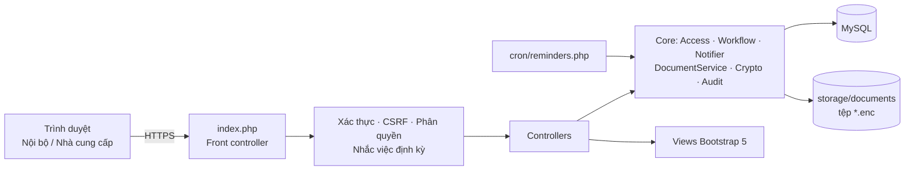
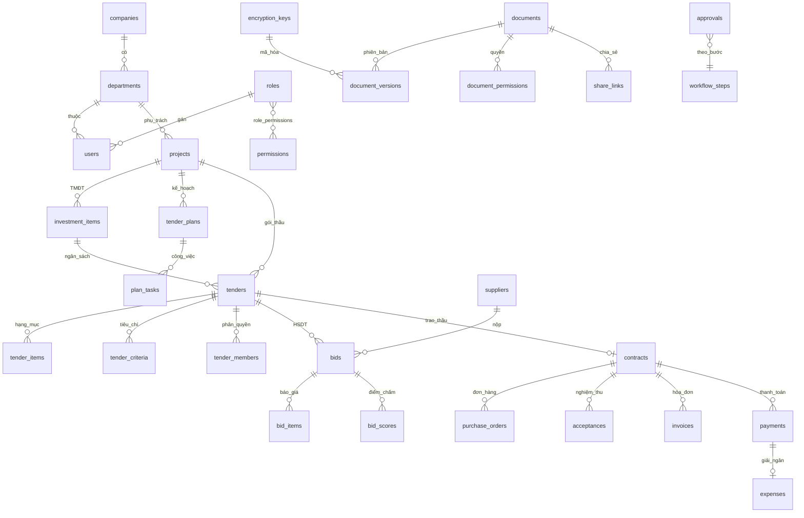
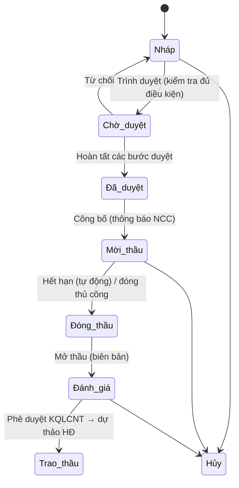

# BÁO CÁO ĐỀ TÀI
# XÂY DỰNG PHẦN MỀM QUẢN LÝ ĐẤU THẦU, MUA SẮM

## 1. Giới thiệu

### 1.1. Bối cảnh

Công tác đấu thầu, mua sắm tại các doanh nghiệp và dự án đầu tư thường gặp nhiều vấn đề:

- Hồ sơ phân tán ở email, ổ đĩa và giấy tờ.
- Khó kiểm soát tiến độ và ngân sách.
- Đánh giá nhà thầu thủ công, dễ thiếu khách quan.
- Thiếu dấu vết kiểm toán.

Phần mềm được xây dựng để số hóa toàn bộ vòng đời đấu thầu trên một nền tảng web tập trung, bảo mật.

### 1.2. Mục tiêu

- Quản lý tập trung hồ sơ mời thầu (HSMT), hồ sơ dự thầu (HSDT) và tài liệu dự án.
- Lập kế hoạch và theo dõi tiến độ đấu thầu theo thời gian thực.
- Lập và kiểm soát tổng mức đầu tư (TMĐT), chi phí; phân tích báo giá.
- Hỗ trợ lựa chọn nhà thầu khách quan, quản lý hợp đồng, giải ngân và quyết toán.
- Cổng thông tin cho nhà cung cấp; bảo mật, phân quyền và nhật ký kiểm toán.

### 1.3. Công nghệ

| Thành phần | Lựa chọn | Lý do |
|---|---|---|
| Ngôn ngữ | PHP 8 | Theo yêu cầu đề tài, phổ biến, dễ triển khai |
| Kiến trúc | MVC thuần + front controller | Không phụ thuộc framework, dễ đọc, dễ chấm |
| CSDL | MySQL / MariaDB (PDO, prepared statements) | Phổ biến, hỗ trợ transaction và trigger |
| Giao diện | Bootstrap 5, Bootstrap Icons, Chart.js | Responsive, thân thiện, biểu đồ trực quan |
| Mã hóa | OpenSSL AES-256-GCM, HMAC-SHA256, bcrypt | Chuẩn công nghiệp |

## 2. Đối chiếu yêu cầu đề tài với chức năng đã xây dựng

### 2.1. Quản lý hồ sơ đấu thầu

| Yêu cầu | Chức năng | Vị trí |
|---|---|---|
| Tạo và công bố HSMT (có tự động hóa) | Tạo HSMT từ **mẫu chuẩn**: hệ thống tự điền 14 biến (tên gói, giá, hình thức, thời điểm đóng thầu…), tự sinh bảng phạm vi cung cấp và tiêu chí đánh giá. Trước khi trình duyệt và công bố, hệ thống kiểm tra đủ điều kiện. Khi công bố, bản HSMT tự lưu vào kho và thông báo tới nhà thầu | Hồ sơ mời thầu, Mẫu HSMT |
| Nộp và theo dõi HSDT trực tuyến | Nhà cung cấp nộp, sửa hoặc rút HSDT đến đúng thời điểm đóng thầu (có đồng hồ đếm ngược). HSDT được **niêm phong điện tử**. Nhà cung cấp theo dõi trạng thái và kết quả | Cổng NCC → Gói thầu / HSDT |
| Kho lưu trữ tập trung, mọi loại tài liệu | Hỗ trợ PDF, Word, Excel, PowerPoint, bản vẽ DWG/DXF, email EML/MSG, ảnh, XML, ZIP. **Tìm kiếm toàn văn** trong nội dung TXT/CSV/XML/DOCX/XLSX/PPTX; lọc theo loại, dự án, phòng ban, mức mật, định dạng | Kho tài liệu |
| Quản lý phiên bản và kiểm toán | Mỗi lần cập nhật tạo phiên bản mới kèm ghi chú; tải được phiên bản cũ; khôi phục; kiểm tra SHA-256; nhật ký truy cập từng tài liệu | Tài liệu → tab Phiên bản / Nhật ký |
| Kiểm soát truy cập theo vai trò và thuộc tính | RBAC (6 vai trò, 30 quyền, ma trận tùy biến) kết hợp ABAC theo **công ty / phòng ban / mã dự án**. Phân quyền theo **từng HSMT** (biên soạn / chuyên gia / chỉ xem). Cấp quyền riêng theo từng tài liệu. 4 mức mật | Người dùng & phân quyền; HSMT → tab Phân quyền; Tài liệu → tab Phân quyền |
| Chia sẻ an toàn | Liên kết có **thời hạn**, **mật khẩu**, **giới hạn lượt tải**, thu hồi được; chống dò mật khẩu; ghi nhật ký IP | Tài liệu → Chia sẻ |
| Mã hóa khi lưu trữ và truyền tải | AES-256-GCM theo mô hình envelope encryption. Hỗ trợ khóa **do khách hàng quản lý (BYOK)**, xoay vòng khóa, thu hồi khóa (crypto-shredding). Hỗ trợ HTTPS bắt buộc và HSTS | Cấu hình → Khóa mã hóa |
| Nhật ký kiểm toán bất biến | Mỗi bản ghi liên kết chuỗi băm HMAC-SHA256. **Trigger CSDL chặn UPDATE/DELETE**. Nút "Kiểm tra toàn vẹn" phát hiện bản ghi bị sửa hoặc xóa | Nhật ký kiểm toán |
| Quản lý nhà cung cấp | CSDL tập trung, tự đăng ký, thẩm định (chờ duyệt / đã duyệt / tạm ngưng / danh sách đen), hồ sơ năng lực, lịch sử đấu thầu, **đánh giá hiệu suất** 4 tiêu chí | Nhà cung cấp |
| Thông báo và nhắc việc | Chuông thông báo cập nhật 30 giây/lần. Nhắc tự động: hạn đóng thầu, NCC chưa nộp, việc sắp hoặc quá hạn, thanh toán đến hạn, hợp đồng sắp hết hạn, phê duyệt tồn đọng. Tự đóng thầu khi hết hạn | Thông báo; `cron/reminders.php` |
| Tự động hóa quy trình cộng tác | Quy trình phê duyệt **nhiều bước cấu hình được** cho HSMT, hợp đồng, thanh toán, kế hoạch. Tự động chuyển trạng thái, thông báo người duyệt tiếp theo, lưu lịch sử | Phê duyệt; Cấu hình → Quy trình |

### 2.2. Kế hoạch đấu thầu và theo dõi tiến độ

| Chức năng | Mô tả |
|---|---|
| Lập kế hoạch và phê duyệt | Theo dự án; có quy trình phê duyệt |
| Tự sinh giai đoạn | 9 giai đoạn chuẩn: Lập HSMT → Thẩm định → Phát hành → Nhận HSDT → Mở thầu → Đánh giá → Thương thảo → Phê duyệt KQ → Ký HĐ |
| Giao việc | Giao cho người hoặc phòng ban; người được giao nhận thông báo và có trang "Việc của tôi" |
| Cập nhật tiến độ | Theo phần trăm và trạng thái (kể cả "vướng mắc"); lịch sử cập nhật |
| Giám sát trực quan | Biểu đồ **Gantt** có vạch "hôm nay"; tô đỏ việc trễ hạn; KPI tiến độ |

### 2.3. Lập và kiểm soát TMĐT, chi phí và phân tích

| Chức năng | Mô tả |
|---|---|
| Cơ cấu TMĐT | 7 nhóm chi phí: xây dựng, thiết bị, GPMB, QLDA, tư vấn, khác, dự phòng. Có dự toán và giá trị được duyệt; tự tính dự phòng theo % |
| Kiểm soát ngân sách | Cảnh báo khi giá gói thầu vượt hạn mức còn lại của khoản mục. Chặn trao thầu vượt giá gói thầu. Cảnh báo và thông báo lãnh đạo khi chi phí vượt dự toán |
| Theo dõi thực tế | So sánh **Được duyệt – Đang đấu thầu – Cam kết (HĐ) – Đã chi – Còn lại** theo khoản mục; ghi nhận chi phí; giải ngân tự hạch toán |
| So sánh báo giá | Theo từng hạng mục (tô ô giá thấp nhất, % chênh so với dự toán); so sánh giá gói thầu – giá thấp/cao nhất – giá trúng thầu – tiết kiệm |
| Dashboard và báo cáo | KPI; biểu đồ trạng thái; TMĐT–cam kết–thực chi; giải ngân theo tháng; **thời gian xử lý bình quân từng giai đoạn** (tính từ nhật ký); hiệu quả theo lĩnh vực và hình thức; hiệu suất NCC; xuất Excel (CSV UTF-8) |

### 2.4. Hỗ trợ lựa chọn nhà thầu, quyết toán và giải ngân

| Chức năng | Mô tả |
|---|---|
| Mở thầu | Chỉ mở sau khi đóng thầu; tự lập **biên bản mở thầu** |
| Đánh giá | Kiểm tra tính hợp lệ; **tổ chuyên gia chấm độc lập** (mỗi người một phiếu), hệ thống lấy trung bình. Số chuyên gia tối thiểu **cấu hình được** (mặc định 3) — Luật Đấu thầu không ấn định số thành viên, chủ đầu tư quyết định theo quy mô gói thầu; chưa đủ số người chấm thì không tính được kết quả |
| Tính điểm | Quy đổi điểm kỹ thuật về thang 100. Điểm giá = giá thấp nhất / giá HSDT × 100 |
| Phương pháp | **QCS** (trọng số KT/giá), giá thấp nhất, hoặc kỹ thuật; xếp hạng tự động; loại HSDT không đạt điểm KT tối thiểu |
| Trao thầu | Nếu không chọn hạng 1 phải giải trình. Tự tạo **quyết định phê duyệt KQLCNT** và dự thảo hợp đồng; thông báo kết quả cho tất cả nhà thầu |
| Hợp đồng | Phê duyệt; **đơn đặt hàng** (NCC xác nhận); **nghiệm thu** (kèm biên bản); **hóa đơn điện tử** (NCC gửi, kế toán kiểm tra) |
| Thanh toán | Mỗi đợt: đề nghị (bắt buộc hóa đơn hợp lệ, nghiệm thu đạt) → duyệt chi nhiều bước → **giải ngân** (tự ghi chi phí dự án, cập nhật hóa đơn "đã thanh toán") |
| Quyết toán | Đối chiếu giá trị HĐ, đặt hàng, hóa đơn, nghiệm thu, đã chi; tạo đợt thanh toán phần còn lại; **đánh giá NCC sau hợp đồng** |
| Cổng thông tin NCC | Hồ sơ doanh nghiệp và năng lực, gói thầu, HSDT/báo giá, kết quả, hợp đồng và thanh toán, xác nhận đơn hàng, hóa đơn điện tử, thông báo |

### 2.5. Yêu cầu phi chức năng

- **Tùy biến**:
  - Ma trận phân quyền và vai trò mới.
  - Quy trình phê duyệt, mẫu HSMT và tiêu chí, số chuyên gia chấm điểm tối thiểu.
  - Cấu hình số ngày nhắc, trọng số mặc định, bật/tắt đăng ký NCC, bắt buộc hóa đơn.
- **Bảo mật**:
  - Mật khẩu bcrypt; khóa tài khoản sau 5 lần sai.
  - CSRF token cho mọi POST; chống SQL injection bằng prepared statements; chống XSS bằng escape đầu ra.
  - Session cookie HttpOnly/SameSite, hết hạn phiên; header bảo mật (HSTS, X-Frame-Options, nosniff).
  - Chặn truy cập trực tiếp thư mục nội bộ; kiểm tra định dạng và kích thước tệp.
- **Giao diện**: tiếng Việt, responsive (máy tính / máy tính bảng / điện thoại), có trang in HSMT theo thể thức văn bản hành chính.

## 3. Thiết kế hệ thống

### 3.1. Kiến trúc

| Lớp lõi | Trách nhiệm |
|---|---|
| `Access` | RBAC + ABAC cho HSMT, tài liệu; niêm phong HSDT; phạm vi dữ liệu nhà cung cấp |
| `Workflow` | Quy trình phê duyệt nhiều bước, tự chuyển trạng thái hồ sơ |
| `Notifier` | Thông báo, nhắc việc tự động, chống trùng lặp |
| `DocumentService` | Lưu trữ mã hóa, phiên bản, trích xuất văn bản để tìm kiếm |
| `Crypto` | Envelope encryption, BYOK, thu hồi khóa |
| `Audit` | Nhật ký chuỗi băm bất biến, kiểm tra toàn vẹn |

### 3.2. Cơ sở dữ liệu (40 bảng, rút gọn)

### 3.3. Vòng đời gói thầu

### 3.4. Mô hình mã hóa và kiểm toán

- **Mã hóa tài liệu**:
  - `app_key` (KEK, nằm ngoài CSDL) bọc các **DEK** 256-bit trong bảng `encryption_keys`.
  - Mỗi phiên bản tệp được mã hóa AES-256-GCM với IV ngẫu nhiên. Tag xác thực giúp phát hiện sửa đổi. Hệ thống kiểm tra thêm SHA-256 của bản rõ.
- **BYOK**:
  - Khách hàng nhập khóa 256-bit của mình và kích hoạt. Từ đó tài liệu mới được mã hóa bằng khóa này.
  - *Xoay vòng* mã hóa lại toàn bộ tài liệu bằng khóa đang hoạt động.
  - *Thu hồi* làm các tài liệu dùng khóa đó không thể giải mã.
- **Nhật ký kiểm toán**:
  - `hash_n = HMAC(app_key, prev_hash ‖ user ‖ action ‖ entity ‖ details ‖ ip ‖ time)`.
  - Trigger `BEFORE UPDATE/DELETE` báo lỗi nên nhật ký không thể sửa hoặc xóa.
  - Chức năng kiểm tra duyệt toàn chuỗi và chỉ ra bản ghi đầu tiên bị can thiệp.

## 4. Kết quả, hạn chế và hướng phát triển

**Kết quả**:

- 20 controller, khoảng 60 màn hình, 40 bảng dữ liệu.
- Đáp ứng đầy đủ 4 nhóm chức năng của đề bài.
- Có dữ liệu mẫu và kịch bản demo trọn vòng đời.

**Hạn chế**:

- Chưa tích hợp ký số (USB token/CA), Hệ thống mạng đấu thầu quốc gia hay hóa đơn điện tử của cơ quan thuế.
- Tìm kiếm toàn văn chưa hỗ trợ PDF scan (OCR).
- Thông báo dùng polling thay cho WebSocket.
- Khóa BYOK được nhập trực tiếp, chưa kết nối KMS/HSM bên ngoài.

**Hướng phát triển**:

- Tích hợp chữ ký số và API muasamcong.
- Gửi email/SMS/Zalo.
- OCR tài liệu.
- Kết nối KMS (AWS KMS, Azure Key Vault, HashiCorp Vault).
- Ứng dụng di động.
- Phân tích dự báo giá bằng dữ liệu lịch sử.

## 5. Dàn ý slide trình bày (15–20 phút)

1. **Tiêu đề**: tên đề tài, sinh viên, đơn vị thực tập, giảng viên hướng dẫn.
2. **Bối cảnh và vấn đề**: hồ sơ phân tán, khó kiểm soát ngân sách/tiến độ, thiếu minh bạch.
3. **Mục tiêu và phạm vi**: 4 nhóm chức năng của đề bài.
4. **Công nghệ và kiến trúc**: sơ đồ mục 3.1.
5. **Thiết kế CSDL**: sơ đồ ER mục 3.2.
6. **Phân quyền**: 6 vai trò, ma trận quyền, quyền theo hồ sơ và thuộc tính.
7. **Quản lý HSMT**: tạo từ mẫu → duyệt → công bố (ảnh chụp màn hình).
8. **Cổng nhà cung cấp**: nộp HSDT, niêm phong, đếm ngược.
9. **Đánh giá và lựa chọn nhà thầu**: chấm điểm nhiều chuyên gia, QCS, so sánh báo giá.
10. **Kế hoạch và tiến độ**: Gantt, giao việc, nhắc việc.
11. **TMĐT và kiểm soát chi phí**: cảnh báo vượt dự toán.
12. **Hợp đồng → giải ngân → quyết toán**: sơ đồ luồng.
13. **Kho tài liệu**: phiên bản, tìm kiếm toàn văn, chia sẻ an toàn.
14. **Bảo mật**: mã hóa AES-256-GCM, BYOK, nhật ký bất biến (demo nút kiểm tra toàn vẹn).
15. **Báo cáo và dashboard**.
16. **Demo trực tiếp**: theo `KICH_BAN_DEMO.md`.
17. **Kết luận, hạn chế, hướng phát triển.**
18. **Hỏi đáp.**
